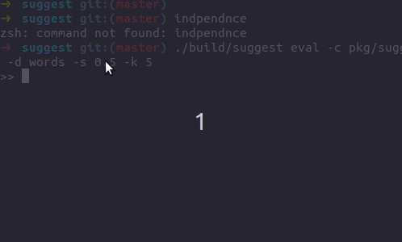
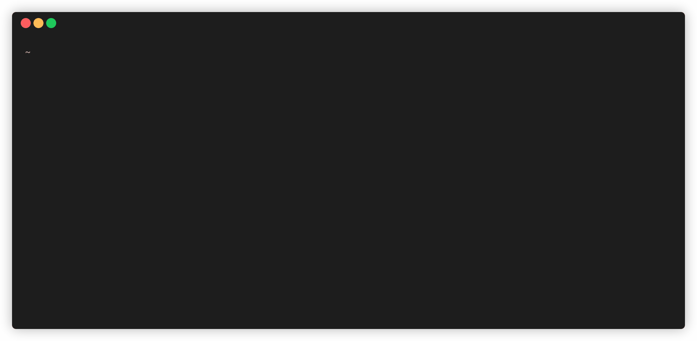

# Suggest

Library for Top-k Approximate String Matching, autocomplete and spell checking.

[](https://travis-ci.com/suggest-go/suggest)
[](https://goreportcard.com/report/github.com/suggest-go/suggest)
[](https://godoc.org/github.com/suggest-go/suggest)

The library was mostly inspired by
- http://www.chokkan.org/software/simstring/
- http://www.aaai.org/ocs/index.php/AAAI/AAAI10/paper/viewFile/1939/2234
- http://nlp.stanford.edu/IR-book/
- http://bazhenov.me/blog/2012/08/04/autocomplete.html
- http://www.aclweb.org/anthology/C10-1096


## Library Usage

The library is organized into sub-packages under `pkg/`. Below are concrete examples for the most common use cases.

### 1. Approximate string search

Find the top-K most similar strings from a dictionary:

```go
import (
    "context"
    "fmt"
    "log"

    "github.com/suggest-go/suggest/pkg/suggest"
    "github.com/suggest-go/suggest/pkg/store"
    "github.com/suggest-go/suggest/pkg/metric"
)

func main() {
    ctx := context.Background()

    // Load a dictionary from disk
    source, err := store.OpenStoreFromFile(ctx, "cars.txt")
    if err != nil {
        log.Fatalf("open store: %v", err)
    }
    defer source.Close()

    // Configure the suggester: Jaro-Winkler distance, top-5 results
    config := suggest.Config{
        Source:        source,
        Metric:        metric.NewJaroWinkler(),
        SuggestAmount: 5,
    }
    suggester, err := suggest.New(config)
    if err != nil {
        log.Fatalf("create suggester: %v", err)
    }

    // Query
    results, err := suggester.Suggest(ctx, "teslla model 3")
    if err != nil {
        log.Fatalf("suggest: %v", err)
    }

    for _, r := range results {
        fmt.Printf("  %s (score=%.3f)\n", r.Value, r.Score)
    }
}
```

### 2. Spellchecking

Detect and correct misspelled words based on a language model:

```go
import (
    "context"
    "fmt"

    "github.com/suggest-go/suggest/pkg/spellchecker"
)

func main() {
    ctx := context.Background()

    // Initialize from a pre-built language model directory
    sc, err := spellchecker.New(ctx, "path/to/lm-folder")
    if err != nil {
        panic(err)
    }
    defer sc.Close()

    // Check a single word
    if suggestions, err := sc.Suggest(ctx, "recieve", 5); err == nil {
        for _, s := range suggestions {
            fmt.Printf("  %s\n", s.Value)
        }
        // Output: receive
    }
}
```

### 3. Custom metric

Implement your own similarity metric by satisfying the `metric.Metric` interface:

```go
import "github.com/suggest-go/suggest/pkg/metric"

type MyMetric struct{}

func (m *MyMetric) Compare(a, b string) float64 {
    // Return 1.0 for identical, 0.0 for unrelated
    // ... your custom comparison here ...
    return 0.0
}

func (m *MyMetric) IsSimilar(a, b string, threshold float64) bool {
    return m.Compare(a, b) >= threshold
}
```

Then plug it into `suggest.Config{Metric: &MyMetric{}}`.

### 4. HTTP service

The package ships with a built-in HTTP server. See `cmd/suggest/service.go` for an example. Quick start:

```go
import (
    "log"
    "net/http"
    "github.com/suggest-go/suggest/internal/http"
)

func main() {
    handler, err := http.NewHandler("path/to/config.json")
    if err != nil {
        log.Fatal(err)
    }
    http.HandleFunc("/suggest", handler)
    log.Fatal(http.ListenAndServe(":8080", nil))
}
```

## Configuration

`suggest` is configured via a JSON file. Minimal example:

```json
{
    "name": "my-suggester",
    "source": {
        "type": "file",
        "path": "data/items.txt"
    },
    "metric": "jaro-winkler",
    "suggest_amount": 5,
    "min_score": 0.5
}
```

The schema is documented in `pkg/suggest/config.go`.

## Package Overview

| Sub-package         | Purpose                                                  |
|---------------------|----------------------------------------------------------|
| `pkg/suggest`       | Core suggester engine (Top-K retrieval)                  |
| `pkg/spellchecker`  | Context-aware spellchecking with language models         |
| `pkg/store`         | Storage backends (in-memory, file-based)                 |
| `pkg/metric`        | Distance metrics (Jaro-Winkler, Levenshtein, Cosine)     |
| `pkg/dictionary`    | Dictionary loaders (plain text, gzip)                    |
| `pkg/index`         | Inverted index for fast lookup                           |
| `pkg/mph`           | Minimal perfect hashing                                  |
| `pkg/vgram`         | Variable-length n-grams                                  |
| `pkg/lm`            | Language model integration (KenLM)                       |
| `pkg/merger`        | Result merging & deduplication                           |
| `pkg/compression`   | Compact storage formats                                  |
| `pkg/utils`         | Shared helpers                                           |

## Performance Tips

- Use `store.Memory` for small dictionaries (<100k entries) — fastest
- Use `store.File` for large dictionaries — saves RAM
- For spellchecking, use the pre-built `lm-folder` shipped with the [language model](https://app.box.com/s/ze53gtxetnqkj5pln7aogge1xo2ca3s0)
- For autocomplete at scale, batch queries with `SuggestBatch(ctx, queries)`

## Further Reading

- [Package documentation on pkg.go.dev](https://pkg.go.dev/github.com/suggest-go/suggest)
- [Project documentation site](https://suggest-go.github.io/)
- [API reference](https://suggest-go.github.io/docs/api/)
- [Demos](https://suggest-go.github.io/docs/demo/)

## Docs

See the [documentation](https://suggest-go.github.io/) with examples demo and API documentation.

## Demo

#### Fuzzy string search in a dictionary

The [demo](https://suggest-go.github.io/docs/demo/suggest-cars.html) shows an approximate string search in a vehicle dictionary with more than 2k model names.

You can also run it locally

```
$ make build
$ ./build/suggest eval -c pkg/suggest/testdata/config.json -d cars -s 0.5 -k 5
```

or by using Docker

```
$ make build-docker
$ docker run -p 8080:8080 -v $(pwd)/pkg/suggest/testdata:/data/testdata suggest /data/build/suggest service-run -c /data/testdata/config.json
```



#### Spellchecker

Spellchecker recognizes a misspelled word based on the context of the surrounding words.
In order to run a spellchecker [demo](https://suggest-go.github.io/docs/demo/spellchecker.html), please do the next

* Download an English [language model](https://app.box.com/s/ze53gtxetnqkj5pln7aogge1xo2ca3s0) built on [Blog Authorship Corpus](http://u.cs.biu.ac.il/~koppel/BlogCorpus.htm)
* Extract downloaded language model and perform
```
$ make build
$ ./build/./spellchecker eval -c lm-folder/config.json
```



## Contributions

When contributing to this repository, please first discuss the change you wish to make via issue, email, or any other method with the owners of this repository before making a change.
